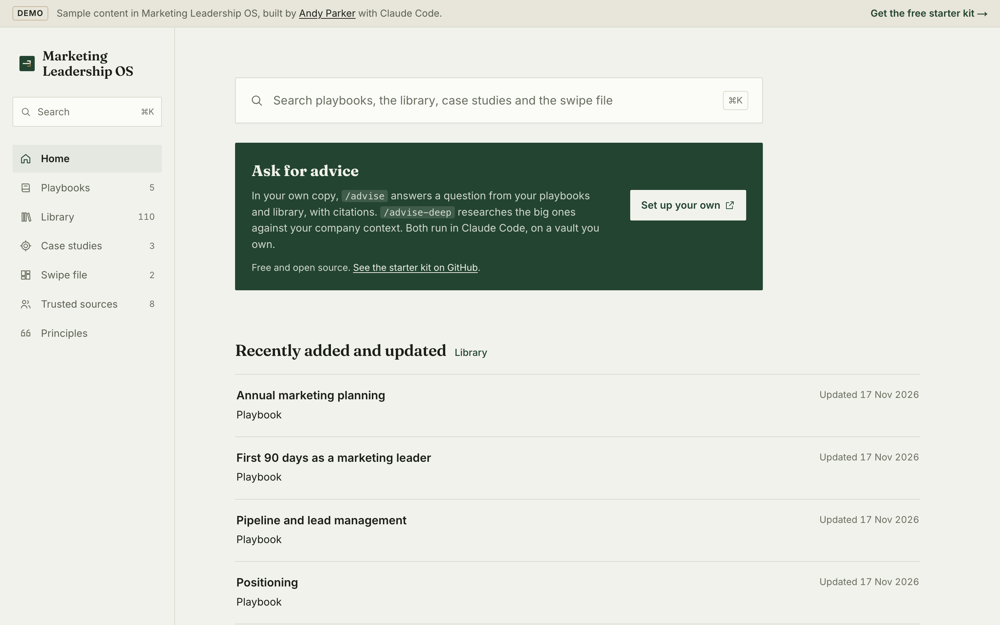
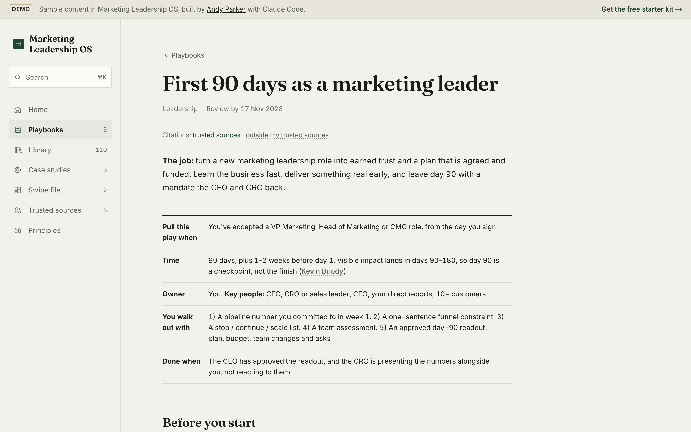

# Marketing Leadership OS: app

A designed, searchable front end for a markdown vault of marketing-leadership knowledge: playbooks, a library of source notes, case studies and a swipe file. The vault stays the source of truth. The app reads it at build time and turns it into a fast reading interface.

**Live demo:** [marketing-os-demo-beta.vercel.app](https://marketing-os-demo-beta.vercel.app), running on the sample content in [`demo-content/`](demo-content).





## What it is

Marketing Leadership OS is a system for running a marketing function from a vault you own, with Claude Code as the operator. The vault holds:

- **Playbooks:** one per recurring leadership job (first 90 days, annual planning, pipeline, positioning). Each is a play you can run, with phases, outputs, traps, a worked example and the evidence behind its default route.
- **Library:** notes on articles, talks and books, each tied to the author it came from.
- **Trusted sources:** the people whose work the playbooks are built on.
- **Case studies and swipe file:** examples worth learning from.
- **Principles:** your own point of view, kept apart from the playbooks.

The free starter kit for the vault itself is [marketing-leadership-os](https://github.com/parkeracs/marketing-leadership-os). This repo is the reading app that sits on top of it.

## Features

- Full-text search across every collection (⌘K), built with MiniSearch at build time
- Wikilinks between notes resolve to pages; unresolved links render as plain text
- Citations styled by whether they come from a trusted source
- Reading trail, mobile navigation and an installable web app manifest
- Two deployment modes from one codebase: a private, signed-in copy on your own vault, and a public demo

## How it works

- **Next.js 16** (App Router) renders every page from markdown with unified, remark and rehype.
- `scripts/fetch-vault.mjs` runs before every build. It points the build at the content folder, cloning the vault repo on Vercel when one is configured.
- `src/lib/vault.ts` loads the vault, parses frontmatter with gray-matter and builds the collections and search index.
- **Private mode:** Supabase magic-link sign-in, limited to one allowed email.

### Demo mode fails closed

With `DEMO_MODE=true` the build refuses to run unless:

- `VAULT_DIR` is set (there is no fallback to a local vault);
- `GITHUB_TOKEN` is *not* set, so a private repo can never be cloned;
- the content folder contains a `.demo-content` marker file, which a private vault never has.

Sign-in and account pages redirect away in demo mode, and a banner marks the content as sample content.

## Run it

```bash
npm install
DEMO_MODE=true VAULT_DIR=demo-content npm run dev
```

To run it on your own vault, put the vault in a sibling folder named `marketing-os` and run `npm run dev`, or set `VAULT_DIR` to its path.

### Deploy on Vercel

- **Demo:** `DEMO_MODE=true` and `VAULT_DIR=demo-content`. Nothing else.
- **Private copy of your own vault:** `VAULT_DIR=.vault`, `VAULT_REPO=<owner>/<your-vault-repo>`, `GITHUB_TOKEN` (fine-grained, read-only, that one repo), `NEXT_PUBLIC_SUPABASE_URL`, `NEXT_PUBLIC_SUPABASE_PUBLISHABLE_KEY` and `ALLOWED_EMAIL`.

## Demo content

`demo-content/` is sample content cleared for public display. Library notes summarise and link to publicly available sources, and belong to their original authors. The playbooks' worked examples use fictional companies.

## How it was built

Built by [Andy Parker](https://www.linkedin.com/in/parkeracs) with Claude Code, as part of running his own marketing-leadership practice on an AI-operated vault.

## Licence

The code is MIT licensed (see [LICENSE](LICENSE)). The sample content in `demo-content/` is provided for demonstration. Quoted and summarised material remains the property of its original authors.
